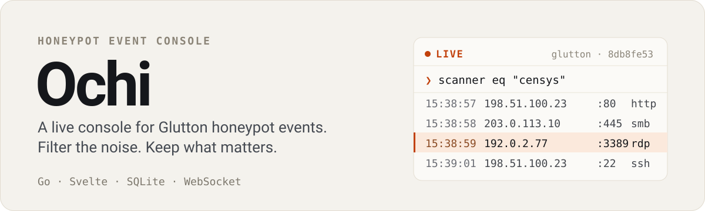
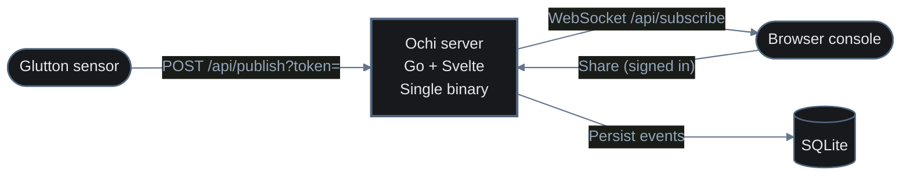

<p align="center">
  
</p>

<p align="center">
  <a href="https://github.com/honeynet/ochi/actions/workflows/go.yml"></a>
  <a href="https://github.com/honeynet/ochi/actions/workflows/svelte.yml"></a>
  
  
  
</p>

Self-hosted, real-time web UI for [Glutton](https://github.com/mushorg/glutton) honeypot events. Watch attacks arrive, filter out the noise with a small query language, and inspect anything worth investigating.

[Live instance](https://ochi.mushmush.org/) · [Quick start](#quick-start) · [Configuration](#configuration) · [Contributing](CONTRIBUTING.md)

## Features

- **Live stream:** events reach every connected browser over a WebSocket, with no polling.
- **Filtering:** query by port, source IP, handler, transport, scanner, end reason or payload, and save filters as tagged queries.
- **Event detail:** frames, hexdump, TLS client hello, matched rule, duration, payload hash and end reason.
- **Share:** store an event and get an unguessable link, so it outlives the live stream.
- **Admin:** register sensors, download their binaries, list users.

## How it works



The live list is not an archive. An event is saved to SQLite only when a signed-in user shares it.

## Quick start

### Prerequisites

> [!NOTE]
> Linux is currently the only supported operating system for running and developing Ochi.

1. [Golang version 1.26 or later](https://go.dev/doc/install)
2. [Node.js 26 or later](https://nodejs.org/en/download/)

### 1. Clone & install dependencies

```bash
git clone https://github.com/honeynet/ochi.git
cd ochi
npm install
```

### 2. Development workflows

Choose the workflow that matches your development needs:

#### For frontend development only

Best for UI modifications, component styling, and query DSL development without compiling or running the Go backend.

1. **Start the development server**:
   ```bash
   npm run dev
   ```
2. **Open the console in your browser**:
   Navigate to [`http://localhost:5000`](http://localhost:5000) (or `http://localhost:8080`).
3. **Enable simulated events**:
   To generate simulated honeypot events without a live feed, click the **Config** button in the top navigation bar and select **Development**. No code changes or manual commenting are required.
   *(Tip: Changing the default `env` store value in [`frontend/store.ts`](frontend/store.ts) to `ENV_DEV` makes development mode the default on load).*

#### For frontend and backend development

Run the complete stack with the Go backend serving the bundled Svelte frontend.

1. **Build the application**:
   ```bash
   make build   # or: npm run build && go build -o server .
   ```
2. **Start the local server**:
   ```bash
   make local   # or: ./server
   ```
   *On first start, the server automatically generates `config.yaml` with local development defaults (`localhost:3000`, publish token `token`, JWT secret `secret`). Pass `-config path/to/config.yaml` to specify an alternate configuration file.*
3. **Open the console in your browser**:
   Navigate to [`http://localhost:3000`](http://localhost:3000).
4. **Generate simulated events**:
   To generate simulated events through the full server, switch to **Development** mode via the **Config** button in the UI.

> [!TIP]
> Set `require_registered_sensors: true` in `config.yaml` to accept published events only from sensors whose UUID exists in the `sensors` table. This is disabled (`false`) by default so newly provisioned sensors are not rejected.

#### For using Ochi with a local Glutton honeypot

Connect a locally running Glutton instance to stream and inspect live sensor events in real time.

1. **Start the Ochi server**:
   ```bash
   make build && make local
   ```
2. **Build the Glutton server**:
   Clone and build Glutton from its [repository](https://github.com/mushorg/glutton).
3. **Configure Glutton producers**:
   Update Glutton's `config.yaml` to enable HTTP event streaming to Ochi:
   - Set `producers.enabled` to `true` ([reference in Glutton config](https://github.com/mushorg/glutton/blob/305a9d23a58d065f49ac25edeaeb374f4fe9c59b/config/config.yaml#L9))
   - Set `producers.http.enabled` to `true` ([reference in Glutton config](https://github.com/mushorg/glutton/blob/305a9d23a58d065f49ac25edeaeb374f4fe9c59b/config/config.yaml#L11))
   - Set `producers.http.remote` to `http://localhost:3000/api/publish?token=token` (replace `token` with the `publish_token` from your Ochi `config.yaml`):

   ```yaml
   producers:
     enabled: true
     http:
       enabled: true
       remote: http://localhost:3000/api/publish?token=token
   ```
4. **Start Glutton server**:
   Launch your Glutton honeypot.
5. **Inspect incoming events**:
   Open [`http://localhost:3000`](http://localhost:3000) in your browser. Events captured by Glutton will appear live in the console stream as they occur.


## Configuration

On first start, the server creates config.yaml with local defaults (localhost:3000, publish token token, JWT secret secret). Pass -config path/to/config.yaml to use a different file.

## Roles

`admin` is the only role ([`backend/entities/role.go`](backend/entities/role.go)).

| Permission | Allows |
|------------|--------|
| `users:list` | Listing all users (`GET /api/users`, **Users** page) |
| `sensors:add_by_id` | Registering a sensor with a chosen UUID (`POST /api/sensors` with `id`) |

The role applies on the user's next login or reload after you add their email to `admin_emails`. Removing the email does **not** revoke it; delete the row from `user_roles`.

## Deployment

```bash
docker build -t ochi .
docker run --rm -p 3000:3000 ochi
```

The image uses `config.docker.yaml` (`0.0.0.0:3000`, placeholder credentials) and has no volume. Mount `database_path` to keep saved data, and supply your own config with real secrets.

### Security

> [!WARNING]
> Never run with the default credentials in production.

- Set strong random `publish_token` and `jwt_secret` values.
- Keep `config.yaml`, `data.db`, `data.db-wal` and `data.db-shm` private (they are gitignored).
- Put Ochi behind a TLS reverse proxy (Caddy, NGINX) to protect tokens and WebSocket traffic.
- Tune `publish_rate_per_sec` and `publish_burst` to your sensor traffic.

## Contributing

Questions and design talk go in [Discussions](https://github.com/honeynet/ochi/discussions), concrete work in [issues](https://github.com/honeynet/ochi/issues). See [`CONTRIBUTING.md`](CONTRIBUTING.md) for tests, formatting and generated files.

## License

[GNU GPL v3.0](LICENSE)