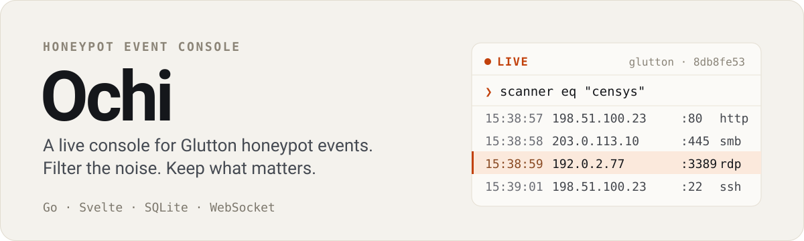
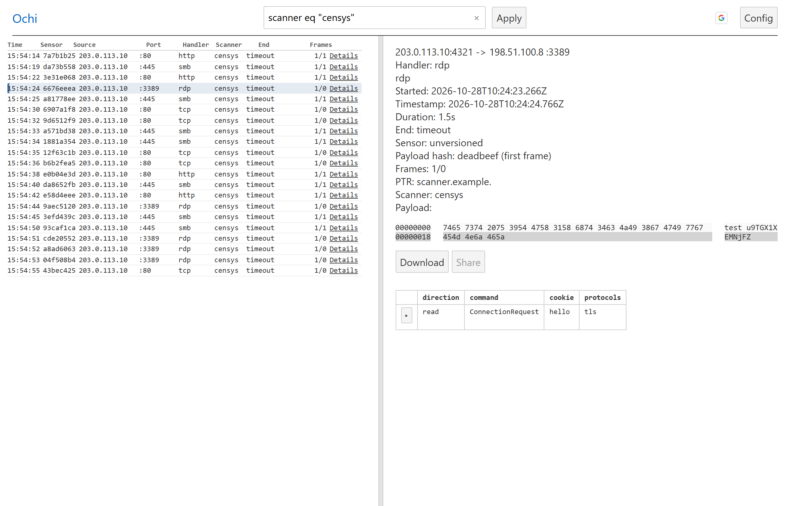
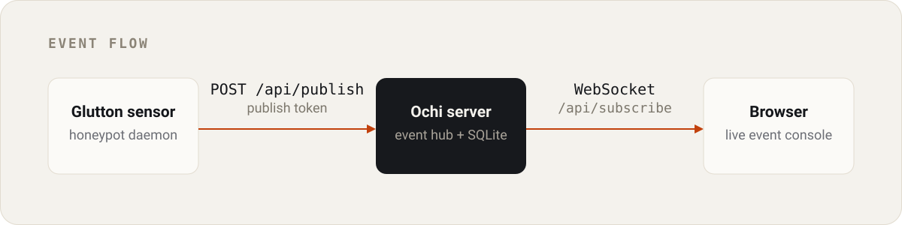

<p align="center">
  
</p>

<p align="center">
  <a href="https://github.com/honeynet/ochi/actions/workflows/go.yml"></a>
  <a href="https://github.com/honeynet/ochi/actions/workflows/svelte.yml"></a>
  
  
  
</p>

Ochi is a self-hosted, real-time web UI for [Glutton](https://github.com/mushorg/glutton) honeypot events. Most of what a public sensor sees is background noise, so Ochi is built around the live stream: watch attacks arrive, filter them with a small query DSL, and open the payload, frames, and hexdump when something is worth investigating.

[Live instance](https://ochi.mushmush.org/) · [Quick start](#quick-start) · [Query syntax](#query-syntax) · [Configuration](#configuration) · [Contributing](CONTRIBUTING.md)

## The console



<sub>Development mode with simulated events. The left side is the live stream; selecting a row opens everything the sensor recorded.</sub>

## What you can do

- **Watch the stream live.** Sensors publish events to Ochi and every connected browser receives them over a WebSocket — no polling, no refresh.
- **Filter the noise.** Narrow events by port, source IP, handler, transport, scanner, end reason, or payload with a short query language, then save useful filters as tagged queries.
- **Inspect the whole event.** Decoded frames, hexdump, TLS client hello, matched rule, duration, payload hash, and end reason are one click away.
- **Keep what matters and share it.** *Share* stores an event and returns an unguessable link, so an interesting capture survives the live stream and can be sent to someone else.
- **Manage your sensors and users.** Register sensors, download their binaries, and — as an admin — list every registered user.

## How it works

<p align="center">
  
</p>

Glutton posts each event to `POST /api/publish` with your publish token. Ochi broadcasts it to subscribers over `/api/subscribe` and renders it in the console. The live list is not an archive: an event is written to SQLite only when a signed-in user shares it. The Go server also serves the Svelte/TypeScript frontend, so a deployment is one binary.

## Quick start

### Prerequisites

> [!NOTE]
> Linux is currently the only supported operating system for running and developing Ochi.

1. [Golang version 1.26 or later](https://go.dev/doc/install)
2. [Node.js 26 or later](https://nodejs.org/en/download/)

### 1. Clone & install dependencies

```bash
git clone https://github.com/honeynet/ochi.git
cd ochi
npm install
```

### 2. Development workflows

Choose the workflow that matches your development needs:

#### For frontend development only

Best for UI modifications, component styling, and query DSL development without compiling or running the Go backend.

1. **Start the development server**:
   ```bash
   npm run dev
   ```
2. **Open the console in your browser**:
   Navigate to [`http://localhost:5000`](http://localhost:5000) (or `http://localhost:8080`).
3. **Enable simulated events**:
   To generate simulated honeypot events without a live feed, click the **Config** button in the top navigation bar and select **Development**. No code changes or manual commenting are required.
   *(Tip: Changing the default `env` store value in [`frontend/store.ts`](frontend/store.ts) to `ENV_DEV` makes development mode the default on load).*

#### For frontend and backend development

Run the complete stack with the Go backend serving the bundled Svelte frontend.

1. **Build the application**:
   ```bash
   make build   # or: npm run build && go build -o server .
   ```
2. **Start the local server**:
   ```bash
   make local   # or: ./server
   ```
   *On first start, the server automatically generates `config.yaml` with local development defaults (`localhost:3000`, publish token `token`, JWT secret `secret`). Pass `-config path/to/config.yaml` to specify an alternate configuration file.*
3. **Open the console in your browser**:
   Navigate to [`http://localhost:3000`](http://localhost:3000).
4. **Generate simulated events**:
   To generate simulated events through the full server, switch to **Development** mode via the **Config** button in the UI.

> [!TIP]
> Set `require_registered_sensors: true` in `config.yaml` to accept published events only from sensors whose UUID exists in the `sensors` table. This is disabled (`false`) by default so newly provisioned sensors are not rejected.

#### For using Ochi with a local Glutton honeypot

Connect a locally running Glutton instance to stream and inspect live sensor events in real time.

1. **Start the Ochi server**:
   ```bash
   make build && make local
   ```
2. **Build the Glutton server**:
   Clone and build Glutton from its [repository](https://github.com/mushorg/glutton).
3. **Configure Glutton producers**:
   Update Glutton's `config.yaml` to enable HTTP event streaming to Ochi:
   - Set `producers.enabled` to `true` ([reference in Glutton config](https://github.com/mushorg/glutton/blob/305a9d23a58d065f49ac25edeaeb374f4fe9c59b/config/config.yaml#L9))
   - Set `producers.http.enabled` to `true` ([reference in Glutton config](https://github.com/mushorg/glutton/blob/305a9d23a58d065f49ac25edeaeb374f4fe9c59b/config/config.yaml#L11))
   - Set `producers.http.remote` to `http://localhost:3000/api/publish?token=token` (replace `token` with the `publish_token` from your Ochi `config.yaml`):

   ```yaml
   producers:
     enabled: true
     http:
       enabled: true
       remote: http://localhost:3000/api/publish?token=token
   ```
4. **Start Glutton server**:
   Launch your Glutton honeypot.
5. **Inspect incoming events**:
   Open [`http://localhost:3000`](http://localhost:3000) in your browser. Events captured by Glutton will appear live in the console stream as they occur.

## Query syntax

Filters are expressions over the fields Glutton sends. The grammar lives in [`frontend/syntax.md`](frontend/syntax.md) and is still evolving.

| Match on | Example |
| --- | --- |
| Payload text | `payload contains "GET /"` |
| Destination port | `tcp.port == 22`, `udp.port == 53` |
| Source IP | `ip.src eq 192.0.2.10` |
| Handler, transport, scanner | `handler eq "http"`, `transport ne "tcp"`, `scanner eq "censys"` |
| End reason | `end.reason == "connection reset by peer"` |
| Boolean combinations | `not scanner eq "censys" and (tcp.port == 22 or tcp.port == 80)` |

Operators are `eq` / `==`, `ne` / `!=`, and `contains`; combine expressions with `and`, `or`, `not`, and parentheses. Apply a filter with Enter or the **Apply** button; with a Google session you can save it as a reusable query with tags.

## Configuration

`config.yaml` is created on first start and every key is optional:

| Key | Default | Purpose |
| --- | --- | --- |
| `listen_address` | `localhost:3000` | Address the server binds to |
| `publish_token` | `token` | Shared secret Glutton sends as `?token=` when publishing |
| `jwt_secret` | `secret` | Signs session tokens |
| `database_path` | `./data.db` | SQLite database for saved events, queries, and sensors |
| `publish_rate_per_sec` | `100` | Sustained ingest rate limit |
| `publish_burst` | `50` | Ingest burst allowance |
| `require_registered_sensors` | `false` | Reject events from sensor UUIDs not in the `sensors` table |
| `admin_emails` | *(empty)* | Google accounts granted the admin role at login |

`require_registered_sensors` is off by default because a sensor that was never registered through `/sensors` — including one provisioned by `/download` — is rejected once it is on.

### Roles

Users hold roles, and each role grants a fixed set of permissions (defined in [`backend/entities/role.go`](backend/entities/role.go)). The only role today is `admin`, which grants:

- `users:list` — list every registered user (`GET /api/users` and the **Users** page).
- `sensors:add_by_id` — register a sensor under a chosen UUID (`POST /api/sensors` with an `id`); without it, the server generates the ID.

Add the account's Google email to `config.yaml` and the role is applied the next time they log in or reload the page:

```yaml
admin_emails:
  - you@example.com
```

Removing an address does **not** revoke the role; delete the row from the `user_roles` table for that.

## Deployment

```bash
docker build -t ochi .
docker run --rm -p 3000:3000 ochi
```

The image starts with `config.docker.yaml` (`0.0.0.0:3000`, placeholder credentials). It keeps no volume by default, so mount `database_path` if saved events and queries should survive a restart, and provide your own config with real secrets.

### Security checklist

> [!WARNING]
> **Do not run with the default credentials in production.** The generated `config.yaml` uses `publish_token: token` and `jwt_secret: secret` for offline development only.

- **Replace the secrets.** Generate strong random values for `publish_token` and `jwt_secret` before exposing the server.
- **Keep private files private.** `config.yaml`, `data.db`, and the SQLite WAL files (`data.db-wal`, `data.db-shm`) hold secrets and event data; they are gitignored.
- **Terminate TLS in front of Ochi.** Use Caddy, NGINX, or another reverse proxy so publisher tokens and WebSocket traffic are encrypted in transit.
- **Tune ingest limits.** Set `publish_rate_per_sec` and `publish_burst` to match your sensor traffic and blunt ingestion floods.

## Contributing

Bug reports, setup questions, and design discussion belong in [Discussions](https://github.com/honeynet/ochi/discussions); concrete work belongs in an [issue](https://github.com/honeynet/ochi/issues). PRs should be small and source-verified — see [`CONTRIBUTING.md`](CONTRIBUTING.md) for tests, formatting, and generated-file requirements.

## License

Ochi is released under the [GNU General Public License v3.0](LICENSE).
